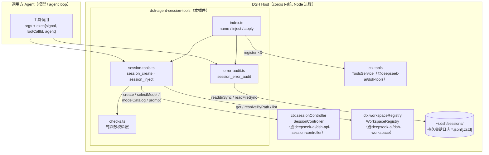
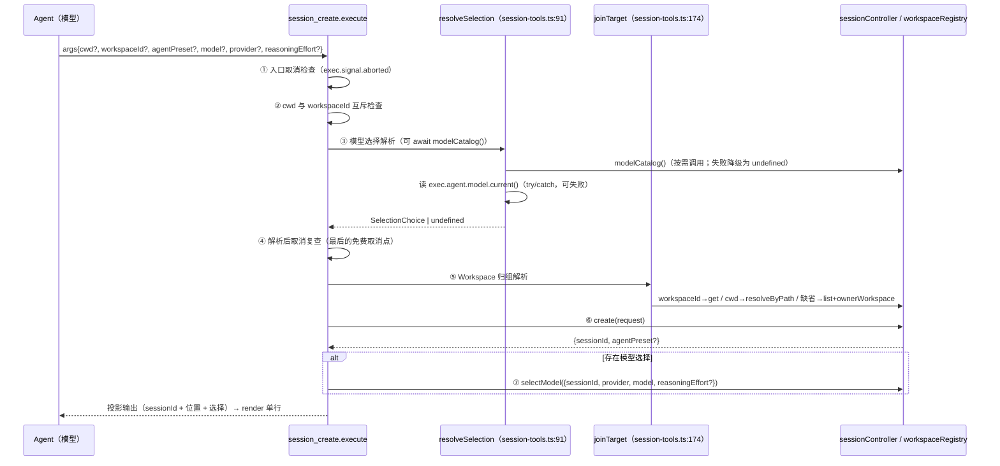
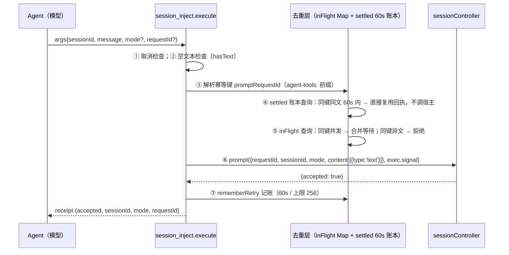
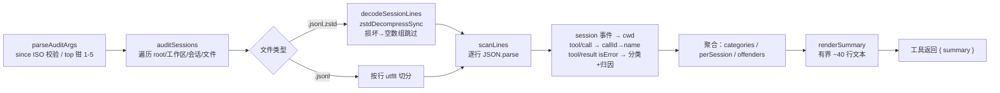
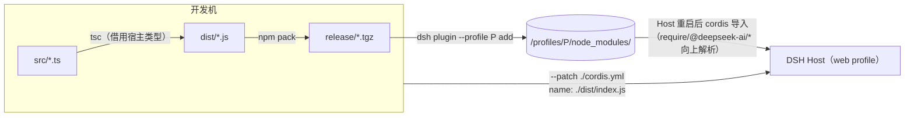

# 02 · 整体架构

## 1. 宿主-插件关系总览



要点：

- 插件运行在**宿主进程内**（Host 侧），没有独立服务、没有网络面、没有配置面
  （模块头注释：`No Client surface, no Config, no state of its own`）。
- 三个工具注册进 `ctx.tools` 后，由宿主统一暴露给 Agent；调用时的执行上下文
  （`exec`）由宿主的 agent loop 传入。
- `session_error_audit` 是唯一**不经过任何宿主服务**的工具：直接读本地日志文件。

## 2. cordis 插件契约

DSH 的插件机制基于 `@deepseek-ai/cordis`（Koishi 系内核）。插件是一个 ES 模块，
导出三样东西（`src/index.ts:11-23`）：

```ts
export const name = 'agent-session-tools'
export const inject = ['tools', 'sessionController', 'workspaceRegistry']

export function apply(ctx: Context): void {
  ctx.effect(() => ctx.tools.register(createSessionTool(ctx)), 'session_create')
  ctx.effect(() => ctx.tools.register(injectSessionTool(ctx)), 'session_inject')
  ctx.effect(() => ctx.tools.register(auditSessionTool(ctx)), 'session_error_audit')
}
```

- **`name`**：cordis 服务目录里的插件标识。
- **`inject`**：声明的服务依赖。宿主在激活插件前先解析这三个键；**任一缺失则插件
  不激活**（静默降级——README 明确说明这是 profile 组合问题而非插件缺陷）。
- **`apply` + `ctx.effect`**：`ctx.tools.register(...)` 返回**精确的反注册闭包**；
  `effect` 把它登记为清理句柄，插件卸载/重载时逐个执行。测试
  （`tests/session-tools.test.ts:110-116`）验证了 disposer 反注册后注册表为空。

## 3. 三个宿主服务

| 服务（inject 键） | 来源包 | 用到的方法 | 用途 |
|---|---|---|---|
| `tools` | `@deepseek-ai/dsh-tools` | `register(definition, options?)`、`defineTool` | 注册工具定义；`defineTool` 是唯一**运行期**包导入 |
| `sessionController` | `@deepseek-ai/dsh-api-session-controller` | `create(request)`、`selectModel(request)`、`modelCatalog()`、`prompt(request, signal)` | 会话创建、模型选择、模型目录、消息注入 |
| `workspaceRegistry` | `@deepseek-ai/dsh-workspace` | `list()`、`get(id)`、`resolveByPath(path)` | Workspace 归组解析 |

## 4. 工具执行上下文（exec）

`defineTool` 的 `execute(args, exec)` 第二参数来自宿主 agent loop。插件用到的成员：

| 成员 | 用在哪 | 语义 |
|---|---|---|
| `exec.signal` | 两个会话工具 | `AbortSignal`：入口检查 + 透传给 `prompt`（`create` 不接收 signal，创建无法中途取消） |
| `exec.rootCallId` | `session_inject` | 幂等键来源：省略 `requestId` 时键为 `agent-tools:<rootCallId>`，执行器重新派发同一 tool call 不会插两条 |
| `exec.agent` | 两个会话工具 | live Agent 运行时面：`agent.model.current()` 读当前模型/effort 选择（用于继承）；`agent.id` 是当前会话 id（用于找所属 Workspace） |

`agent` 的类型契约只宽泛声明，但 agent loop 派发时传的是 live 运行时 Agent
（`dsh-agent-loop/src/agent.ts` 以 `agent: this` 派发）。插件对它**防御性读取**：
`currentSelection()` 用 try/catch 包裹，读不到就当作"没有模型可抄"，退化为部署默认。

## 5. 数据流一：`session_create`



阶段 ③ 的解析顺序（`resolveSelection`）决定了"哪些错误发生在创建之前"：

1. `model` / `provider` / `reasoningEffort` 拒绝纯空白取值；
2. `provider` 必须与 `model` 同用；
3. 完全不指定模型 → 整体抄当前选择（无 Agent 则 undefined，走部署默认）；
4. 只给 `reasoningEffort` → 必须有可继承的模型，effort 按目录校验；
5. 给了 `model` → provider 解析：显式 `provider` > 同模型 id 沿用当前路由 >
   目录反查（目录不可用则直接报错要求显式 provider）；
6. effort：显式给 → `checkedEffort`（可见目录不提供则创建前报错）；继承 →
   `carriedEffort`（新模型不提供时降级为 `defaultEffort`）。

## 6. 数据流二：`session_inject`



为什么需要本地去重层：宿主的 `hasPromptRequest` 只查 inbox 与已落盘历史；消息
离开 inbox 到它的 `user/message` 落盘之间存在窗口，同键第二次调用在该窗口内查不到
任何东西（README「去重有窗口缺口」）。in-flight 表覆盖**并发**重叠，60 秒账本覆盖
**串行**重试；超出窗口/跨进程的重试仍由宿主按持久历史去重。

## 7. 数据流三：`session_error_audit`



设计约束：**只读 + 有界**。错误文本在抽取时截断 200 字符，汇总行数硬封顶，
"detail 永远在磁盘上，调用方需要时再用 read 翻特定会话"（模块头注释）。

## 8. 部署拓扑



- **发布路径**：tarball 装进 profile 的 `node_modules`，`@deepseek-ai/*` 从
  `<DSH_HOME>/profiles/node_modules` 向上解析成立。直接 `add` 本地目录会装成
  `link:`，Node 从工作区真实路径解析会得到 `ERR_MODULE_NOT_FOUND`（README 明确
  记录，勿用）。
- **开发路径**：`dsh --profile <profile> --patch ./cordis.yml` 免打包直接挂
  `./dist/index.js`，本目录的 node_modules 垫片同时服务类型期与运行期解析。
- **profile 前置**：需要 `session-controller` 宿主行（`web` profile 自带；
  `headless` 没有，需用 patch 叠加层补 `session-controller` / `connection` /
  `file-upload` / `workspace` 四行）。缺行时插件因 `inject` 未满足而不激活。

## 9. 错误处理统一约定

- 所有宿主调用失败经 `describeFailure(tool, error)` 包装：`"<tool名>: <宿主消息> (<code>)"`，
  `code` 来自 `codeOf()` 对 `error.code` 的宽容读取；
- `selectModel` 在会话已创建之后失败时，错误文本**点名已创建的 sessionId**：
  `session <id> was created but its model selection failed: …`，调用方仍可向它
  `session_inject`；
- 插件侧前置错误（互斥、空文本、非法 requestId、模型歧义等）都在触碰宿主之前
  抛出，测试用 `recorded.create` / `recorded.prompt` 为空来断言这一点。
