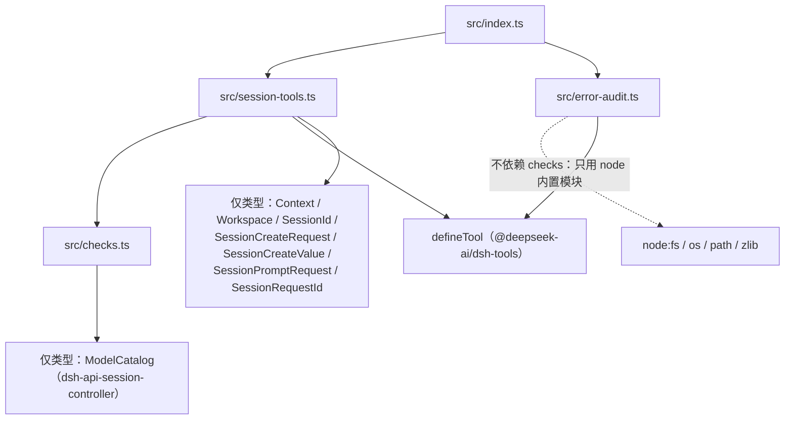

# 03 · 目录结构与模块职责

## 1. 目录树

```
dsh-agent-session-tools/
├── docs/wiki/                  本 Wiki（生成物，可随仓库维护）
├── src/
│   ├── index.ts                插件入口：name / inject / apply（23 行）
│   ├── session-tools.ts        session_create / session_inject 定义与执行逻辑
│   ├── error-audit.ts          session_error_audit：日志扫描与有界汇总
│   └── checks.ts               两个会话工具共享的纯函数校验层
├── tests/
│   ├── checks.test.ts          checks.ts 直接单测（29 项）
│   ├── session-tools.test.ts   注册、create/inject 全流程（43 项，fake ctx）
│   └── error-audit.test.ts     分类/归因/参数/解码（6 项）
├── scripts/
│   └── build.mjs               tsc 运行器 + node_modules 垫片（无依赖构建）
├── dist/                       构建产物（gitignore）：checks.js / session-tools.js /
│                               error-audit.js / index.js + 各自 .d.ts
├── release/                    tarball + SHA256SUMS.txt（gitignore）
├── locale/
│   ├── en.json                 Plugin Manager 标题/描述（英文）
│   └── zh.json                 Plugin Manager 标题/描述（中文）
├── cordis.yml                  开发期 composition：name: ./dist/index.js，--patch 直挂
├── cordis.patch.yml            安装期 patch：insert 一行插件条目
├── icon.svg                    插件图标（Plugin Manager）
├── package.json                入口/exports/files/dsh.bundle.patch/engines
├── tsconfig.json               编辑器用，extends typecheck
├── tsconfig.typecheck.json     严格类型检查（noEmit，含 tests/）
├── tsconfig.build.json         产出 dist/ + .d.ts（rootDir src）
├── vitest.config.ts            测试配置（node 环境，forks pool）
├── pack.ps1 / pack.cmd / pack.sh  一键打包（build → test → pack → 校验 → SHA256）
├── README.md                   语义与验证记录（内容详尽，但落后于 v1.4.0 工作区）
├── LICENSE                     MIT
└── .gitignore                  node_modules/ dist/ *.tgz SHA256SUMS.txt
```

## 2. 模块依赖关系（源码层面）



关键边界：

- `checks.ts` **不 import 任何 @deepseek-ai 运行时代码**（只有 `node:fs`、
  `node:path`、`node:crypto` 与一个类型导入），因此可以在任何 vitest 环境
  直接测试；
- `error-audit.ts` 与会话工具**互相独立**，只共享 `defineTool`；
- `index.ts` 是唯一的装配点，不含逻辑。

## 3. 各文件职责

### src/index.ts —— 插件入口（装配层）

| 导出 | 行号 | 说明 |
|---|---|---|
| `name` | `:11` | 插件标识 `'agent-session-tools'` |
| `inject` | `:12` | `['tools', 'sessionController', 'workspaceRegistry']` |
| `apply(ctx)` | `:19-23` | 三次 `ctx.effect(() => ctx.tools.register(...))`；effect 负责在插件卸载时执行反注册闭包 |

### src/session-tools.ts —— 会话工具（领域层）

职责：两个会话工具的 `defineTool` 定义（参数 DSL、输出 schema、render、execute），
加上两块解析逻辑——**模型选择解析**与 **Workspace 归组解析**。

| 导出/内部函数 | 行号 | 职责 |
|---|---|---|
| `currentSelection(exec)` | `:47-63` | 防御性读取 `exec.agent.model.current()`，失败/缺失一律返回 undefined |
| `lookupCatalog(ctx)` | `:70-76` | 每 call 最多取一次模型目录；目录故障不阻断不需要它的选择 |
| `resolveSelection(ctx, args, exec)` | `:91-146` | 合并"调用方模型参数 × 当前会话选择"为唯一 SelectionChoice；可命名错误全部在 create 前抛出 |
| `resolveProvider(model, ctx)` | `:149-155` | 目录不可用时显式报错，绝不猜路由 |
| `joinTarget(ctx, args, exec)` | `:174-183` | 三级归组：workspaceId → cwd 反查 → 当前会话所属 Workspace |
| `createSessionTool(ctx)` | `:185-300` | `session_create` 全量定义 |
| `injectSessionTool(ctx)` | `:307-406` | `session_inject` 全量定义；闭包持有 `inFlight` 与 `settled` 两张表 |
| `InjectReceipt` | `:409-414` | 注入回执形状 |

### src/error-audit.ts —— 错误审计（分析层）

职责：只读扫描 `~/.dsh/sessions`，把 `isError` 工具结果聚合为有界汇总。

| 导出/内部函数 | 行号 | 职责 |
|---|---|---|
| `ErrorRecord` | `:23-28` | 预留接口，当前未被运行时路径引用 |
| `ErrorAuditInput` / `parseAuditArgs` | `:31-49` | 参数默认与钳制：`top` 1–5（默认 3）；`since` 必须 ISO 8601 |
| `classifyErrorText(text)` | `:57-68` | 顺序敏感的分类词表 → 10 个稳定类别 |
| `offenderOf(text)` | `:71-77` | 从错误文本提取引号内文件路径或命令头 |
| `defaultSessionsRoot()` | `:80-82` | `join(homedir(), '.dsh', 'sessions')` |
| `decodeSessionLines(bytes)` | `:92-99` | 原生 zstd 同步解码；损坏→空数组（跳过不失败） |
| `auditSessions(root, input)` | `:109-145` | 三层目录遍历 + 聚合 + 渲染 |
| `scanLines(lines, sinceMs)` | `:148-186` | 单文件事件解析（内部） |
| `plainText` / `topEntries` / `renderSummary` | `:189-227` | 内容拼接 / 排序（计数降序、键升序保确定性）/ 有界渲染（内部） |
| `auditSessionTool(ctx)` | `:237-263` | `session_error_audit` 全量定义；`ctx` 目前未用（参数占位保持服务对齐） |

### src/checks.ts —— 共享校验（纯函数层）

全部导出无副作用（除 `checkedCwd` 的一次 `statSync` 探测），按用途分四组：

| 组 | 导出 | 说明 |
|---|---|---|
| 参数校验 | `checkedCwd`、`hasText` | 绝对目录校验；非空白文本判定 |
| 幂等键 | `requestIdPrefix`、`promptRequestId` | `agent-tools:` 命名空间；三种键来源与合法性 |
| 重试账本 | `retryWindowMs`、`retryLedgerLimit`、`RetryRecord`、`lookupRetry`、`rememberRetry` | 60 秒窗口 / 256 条上限的已完成键账本 |
| 宿主适配 | `ownerWorkspace`、`describeFailure`、`codeOf` | 会话→Workspace 反查；错误包装与 code 提取 |
| 模型目录 | `SelectionChoice`、`providerOfModel`、`checkedEffort`、`carriedEffort`（内部 `entryOf`、`effortList`） | provider 反查、effort 校验、继承降级 |

### tests/ —— 测试层

| 文件 | 项数 | 策略 |
|---|---|---|
| `checks.test.ts` | 29 | 直接驱动纯函数；`checkedCwd` 用 `tmpdir` 临时目录 |
| `session-tools.test.ts` | 43 | 手写 **fake ctx**（`makeContext`）：只记录不实现的 `sessionController`、可配置 `workspaceRegistry`、即跑即存 disposer 的最小 `effect`；覆盖注册/反注册、create/inject 全分支、取消、幂等三层 |
| `error-audit.test.ts` | 6 | 纯函数：分类词表、归因正则、参数钳制、损坏字节容错 |

### scripts/build.mjs —— 构建基建

无依赖构建的核心（详见 [06 依赖关系](06-dependencies.md)）：
查找可借用的 deps root → 逐条目链接 typescript / @types / @standard-schema /
vitest / @deepseek-ai/* 进本地垫片 → 写 Windows 可用的 `vitest.cmd` →
`spawnSync(node, tsc.js, ['-p', config])`。

### 配置三件套（tsconfig）

| 文件 | 用途 | 关键差异 |
|---|---|---|
| `tsconfig.typecheck.json` | 严格检查基准 | `strict`、`exactOptionalPropertyTypes`、`noEmit`、include `src+tests` |
| `tsconfig.build.json` | 产出 dist | extends typecheck；`noEmit:false`、`outDir:dist`、`rootDir:src`、`declaration:true`、`rewriteRelativeImportExtensions:true`（源里的 `./checks.ts` 导入在产物中变成 `./checks.js`） |
| `tsconfig.json` | 编辑器 | 只 extends typecheck |

### 打包与本地化

- `cordis.patch.yml`：安装期往 profile patch 一行 `- id: agent-session-tools / name: dsh-agent-session-tools`；
- `cordis.yml`：开发期 `--patch` 叠加层，条目直接指 `./dist/index.js`；
- `locale/en.json`、`locale/zh.json`：Plugin Manager 的标题/描述；
- `pack.ps1`（Windows 主入口）/ `pack.sh`（bash 复刻）/ `pack.cmd`（转发 ps1）：
  见 [07 构建与运行](07-build-and-run.md)。
