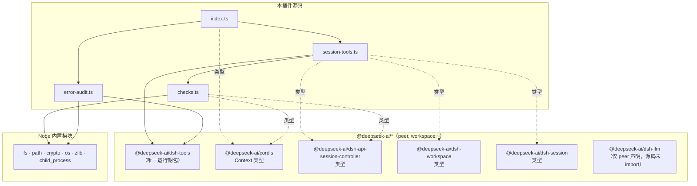

# 06 · 依赖关系

## 1. 依赖全景

本项目**运行期几乎零依赖**：唯一的 `@deepseek-ai` 运行期 import 是
`defineTool`（`src/session-tools.ts:11`、`src/error-audit.ts:14`）；其余全部是
类型导入（转译期擦除）与 Node 内置模块。`peerDependencies` 六个包全部声明为
`workspace:~`，**装包时不安装**，运行期由 DSH profile 的 `node_modules` 提供。

### 逐文件 import 清单

| 文件 | 运行期 import | 类型期 import |
|---|---|---|
| `src/index.ts` | — | `Context`（@deepseek-ai/cordis） |
| `src/session-tools.ts` | `defineTool`（@deepseek-ai/dsh-tools） | `Context`、`Workspace/WorkspaceId`（dsh-workspace/types）、`SessionId`（dsh-session）、`ModelCatalog/SessionCreateRequest/SessionCreateValue/SessionPromptRequest/SessionRequestId`（dsh-api-session-controller） |
| `src/error-audit.ts` | `defineTool`（dsh-tools）、`node:fs`、`node:os`、`node:path`、`node:zlib` | `Context` |
| `src/checks.ts` | `node:fs`（statSync）、`node:path`（isAbsolute）、`node:crypto`（randomUUID） | `ModelCatalog`（dsh-api-session-controller） |
| `tests/*` | vitest、`node:fs`、`node:os`、`node:path` | 同上类型 + `ToolDefinition/ToolRunContext`（dsh-tools） |

### 依赖图

> 注意：`@deepseek-ai/dsh-llm` 只出现在 `peerDependencies` 里，源码没有任何
> import——它是宿主 `selectModel` 校验链路的传递性依赖声明。

### peerDependencies（package.json:46-53）

| 包 | 作用 | 使用深度 |
|---|---|---|
| `@deepseek-ai/cordis` | 插件内核（Context/effect/inject） | 类型 |
| `@deepseek-ai/dsh-api-session-controller` | `ctx.sessionController` 服务 | 类型（运行期经 ctx 取用） |
| `@deepseek-ai/dsh-tools` | `defineTool` / 工具注册 | **运行期** |
| `@deepseek-ai/dsh-session` | `SessionId` 品牌 id | 类型 |
| `@deepseek-ai/dsh-workspace` | `ctx.workspaceRegistry` 服务 | 类型 |
| `@deepseek-ai/dsh-llm` | 模型校验链路（未直接 import） | — |

## 2. 运行环境要求

| 项 | 要求 | 原因 |
|---|---|---|
| Node.js | `>= 22.19.0`（`engines`） | `zstdDecompressSync`（error-audit）与较新的语法目标（`target: es2024`） |
| 运行位置 | 仅 DSH Host 侧 | 工具注册进 `ctx.tools`；无 Client 面 |

**profile 组合前置**（README「依赖与前置条件」）：

- 需要 profile 已挂 `session-controller`（`@deepseek-ai/dsh-api-session-controller`）；
- `web` profile 自带；`headless` profile **没有**，且还缺 `inject` 所需的
  `connection` / `file-upload` / `workspace`——缺行时插件因 `inject` 未满足而
  **静默不激活**（不是缺陷，是组合问题；可用 `--patch` 叠加层补齐）；
- 由于 `inject` 含 `workspaceRegistry`，**没有 workspace 行的 profile**（如裸
  headless）里本插件整个不激活。

## 3. 无依赖构建：`scripts/build.mjs` 垫片机制

本仓库刻意**不 `npm install`**（保持 checkout 干净、类型始终对齐宿主）。
`scripts/build.mjs` 是 `npm run build` / `typecheck` / `test` 的统一入口：
先把需要的包**链接**进本目录 `node_modules`（垫片，gitignore），再跑
`tsc -p <config>`。

### 3.1 deps root 查找顺序（`findDepsRoots`，`build.mjs:80-107`）

| 优先级 | 来源 | 说明 |
|---|---|---|
| 1 | `$DSH_NODE_MODULES` | 直接指定一个 node_modules 目录 |
| 2 | `$DSH_HOME/node_modules` | 指定一个 DSH checkout 根 |
| 3 | `./node_modules` | 上次运行留下的垫片，或真实 install |
| 4 | **DSH checkout**：`D:/Program files/deepseek-harness/node_modules`（脚本内常量 `:40`）+ 其每个 `/media` 挂载翻译 | checkout 优先于兄弟项目——published 包的类型面可能落后 |
| 5 | 兄弟项目：上一级与上两级目录里每个 `*/node_modules` | 插件可能与其他插件项目并排放 |

**资格判定**（`qualifies`，`:55-61`）：目录里有 `typescript/lib/tsc.js` +
`@types/node/package.json`，且 `@deepseek-ai/cordis/package.json` 存在（published
布局）**或** 同级的 `vendor/cordis/package.json` 存在（checkout 布局）。

### 3.2 两种 deps root 布局（`build.mjs` 头注释）

| 布局 | `@deepseek-ai/*` 的位置 |
|---|---|
| published | `node_modules/@deepseek-ai/*` 是真实包 |
| checkout | 是 workspace 链接，真正的包在 `packages/<group>/<name>` 与 `vendor/<name>`，`cordis`/`cosmokit` 在 `vendor/` 下需要 alias |

### 3.3 链接策略（本机适配的关键差异）

相比同工作区 `adaptive-effort-scheduler` 的同名脚本，本版为 Windows + checkout
布局改了四处（README §构建与打包）：

1. **checkout 候选按字面路径再试一次**：Windows 没有 `/media`，只做挂载翻译会
   永远落空（`build.mjs:91` —— `[checkout, ...windowsMounts(checkout)]`）；
2. **`@types` / `@deepseek-ai` 逐条目链接，不整目录链接**（`shimTree`，`:165-185`）：
   pnpm 的条目本身是相对符号链接，整目录 junction 会让它们指向错误位置
   （表现为 `Cannot find type definition file for 'node'`）；
3. **checkout 布局按 manifest `name` 扫描**（`shimCheckoutScope`，`:248-263`）：
   遍历 `packages/<group>/<name>` 与 `vendor/<name>`，读各目录 `package.json`
   的 `name`，把 `@deepseek-ai/<name>` 链到对应目录——checkout 根的
   `node_modules/@deepseek-ai` 只有根包依赖的几个，插件要用的
   `dsh-tools` / `dsh-api-session-controller` / `dsh-session` 不在里面；
4. **Windows `.bin` 不整目录链接**：写一个 `vitest.cmd` 指向借用的
   `vitest/vitest.mjs`（`:203-214`），`npm test` 直接可用。非 Windows 则把候选
   `.bin/vitest` 用**一次单断言冒烟运行**探测后再 symlink（`:216-240`）——
   跨 OS 借来的 vitest 可能在加载原生 bundler 绑定时才炸。

其余细节：

- 垫片**只增不改**：已解析的条目不动（真实 `npm install` 优先），仅替换指向
  别处的失效链接（`shimLink`，`:136-146`）；
- `vitest` **包本体**也被链接（`:194-195`，从多个 deps root 里探测携带者），
  否则 `tsc` 无法类型检查 `tests/`（vitest 的 import 会解析失败）；
- `@standard-schema` 一起链接（`:191`，dsh-tools 的 schema DSL 依赖）；
- 编译器可用 `$DSH_TSC` 指定（默认垫片里的 `typescript/lib/tsc.js`）；
- 最后校验垫片可用（`providesNodeModules`，`:289-292`）再 `spawnSync` tsc，
  退出码透传。

### 3.4 环境变量速查

| 变量 | 作用 |
|---|---|
| `DSH_NODE_MODULES` | 直接指定 node_modules 目录（最高优先级） |
| `DSH_HOME` | 指定 DSH checkout 根（用其 node_modules） |
| `DSH_TSC` | 显式 tsc.js 路径（默认用垫片里的） |

## 4. 分发与安装链路

- `package.json` 的 `files` 只含运行文件：`dist`、两份 cordis yml、README、
  LICENSE、`locale/*.json`、`icon.svg`（`src/`、`tests/`、`scripts/` 天然不进包；
  pack 脚本还有一道**禁止清单**校验，见 [07](07-build-and-run.md)）；
- `dsh.bundle.patch: ./cordis.patch.yml`（`dsh` 字段）：安装期往 profile patch
  一行插件条目（cordis.patch.yml 的 `insert`）；
- peer 全是 `workspace:~`：装进 profile 时 pnpm 会给一句 peer 警告（与
  `@local/adaptive-effort-scheduler` 表现一致），不影响加载；
- 运行期解析依赖 profile 的 `node_modules/@deepseek-ai/*` 向上可达——所以
  **必须装 tarball**，不能 `dsh plugin add <本地目录>`（会装成 `link:`，Node 从
  工作区真实路径解析失败：`ERR_MODULE_NOT_FOUND: '@deepseek-ai/dsh-tools'`）。
